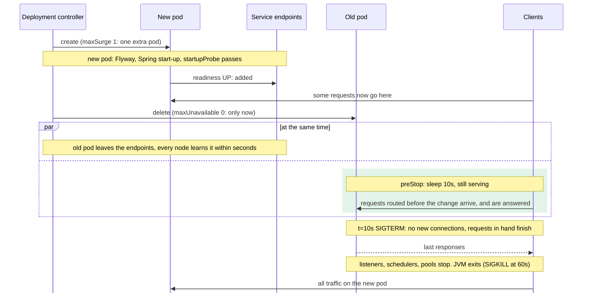

# Bonus Episode 13 — Deploying to Kubernetes

Git tag: `bonus-13-kubernetes` · Builds on: [Bonus Episode 12 — Rate Limits per Customer](bonus-12-rate-limits.md)

## Goal

The service runs on Kubernetes as two or more pods. Pods get replaced all the
time: a rolling update, a node drained for maintenance, a node that dies. None
of that may fail a request or lose a payment. Everything the service needs to
know about its environment comes from outside the image.

```text
$ deploy/k8s/smoke.sh
...
--- rolling restart
Waiting for deployment "payment-service" rollout to finish: 1 out of 2 new replicas have been updated...
deployment "payment-service" successfully rolled out
--- 1728 requests, 0 failed; waiting for 864 payments to be final
OK: no failed request, every payment final
```

Payment business rules don't change. The application gets four settings and
one more permitted path. Everything else is new files under `deploy/k8s/`.

## What the earlier episodes already did

Most of this episode was done before it started:

- **Stateless HTTP.** No session, no in-memory state a request depends on
  (B1). Any pod can answer any request, so the Service may send each one
  anywhere.
- **Configuration from outside** (Episode 19). Every address and credential
  is a property, set by an environment variable. The image that ran in Docker
  Compose runs here unchanged.
- **Safe on several instances** (B7). Schedulers that must run once take a
  ShedLock lock; the relay and the webhook dispatcher claim rows with
  `SKIP LOCKED`; rate-limit buckets are shared (B12). Two pods are just two
  instances.
- **Offsets committed after the work** (Episode 17). A consumer that stops,
  cleanly or not, leaves its uncommitted records for the next owner of the
  partition.
- **Outcomes that are never lost** (Episode 16, B2). A pod killed during
  `execute` leaves a payment `PROCESSING`, and reconciliation settles it.

## The manifests

```text
deploy/k8s/
├── base/                      the service, as every environment runs it
│   ├── deployment.yaml        probes, preStop, resources, JVM sizing, spread over nodes
│   ├── service.yaml
│   ├── pdb.yaml               minAvailable: 1
│   └── hpa.yaml               2 to 4 pods on CPU
├── local/                     the kind cluster: image tag, ConfigMap, Secret, and stand-ins
│   ├── postgres.yaml, kafka.yaml, schema-registry.yaml, external-systems.yaml
│   ├── observability.yaml     Tempo, Loki, Prometheus (finds pods itself), Grafana
│   └── prometheus.yml
├── kind.yaml                  1 control plane + 2 workers, localhost:30080
└── smoke.sh
```

### Kustomize, not Helm

There is one service, deployed by the team that writes it. Kustomize's
manifests are plain Kubernetes YAML: each file is valid on its own, and an
overlay patches the base. It is built into `kubectl`, so there is nothing
to install.

Helm is a template language plus a package format. It pays off when a chart
is **distributed** to people who install it with their own values: dozens of
knobs, a chart repository, releases with rollback. None of that applies here.
Every `{{ if }}` would be a second language to read before seeing what is
actually deployed.

### kind, not k3d

Both run a cluster in Docker containers. **kind** runs upstream Kubernetes,
built with kubeadm, the same distribution the Kubernetes project uses for its
own conformance tests. It is also preinstalled on GitHub's Ubuntu runners.
**k3d** runs k3s, a lighter distribution with its own defaults: Traefik,
its own load balancer, flannel and SQLite instead of etcd. It starts
faster, but a test on it tests k3s's defaults too.

### Configuration and secrets

The base Deployment reads every setting from a ConfigMap and a Secret, both
named `payment-service`, which the overlay generates:

```yaml
configMapGenerator:
  - name: payment-service
    literals:
      - SPRING_DATASOURCE_URL=jdbc:postgresql://postgres:5432/payments
      - SPRING_KAFKA_BOOTSTRAP_SERVERS=kafka:9092
      ...
secretGenerator:
  - name: payment-service
    literals:
      - SPRING_DATASOURCE_PASSWORD=payments
      - PAYMENT_SECURITY_LOCAL_JWT_SECRET=local-only-example-key-not-a-real-secret-0001
```

A generated name carries a hash of its content (`payment-service-mfk9829b26`).
Changing a value changes the name the Deployment refers to, and that rolls the
pods. A fixed name would change under running pods, which never re-read their
environment.

Locally the service runs the `local` profile and accepts tokens signed with
the shared key (B1). A real overlay leaves the profile off and puts
`SPRING_SECURITY_OAUTH2_RESOURCESERVER_JWT_ISSUER_URI` in its Secret. The
issuer isn't secret, but it decides which tokens are trusted, so it belongs
with the credentials. Every value here is an example for the local cluster
only, as in `docker-compose.yml`.

### The systems the service talks to

PostgreSQL, Kafka, the schema registry, the WireMock stand-in and the
observability tools exist **only in the local overlay**, and each is as small as
it can be: one pod, data on the pod's own disk (`emptyDir`), gone when the pod
goes. In production these are managed services (a managed PostgreSQL and
Kafka, the platform's tracing and logging). The service doesn't care: only the
addresses in the ConfigMap change. They have been properties since Episode 19.

Two details that only show up on Kubernetes:

- **`enableServiceLinks: false` on Kafka.** For a Service named `kafka`,
  Kubernetes adds variables like `KAFKA_PORT=tcp://10.96.0.12:9092` to every
  pod in the namespace. The Kafka image turns every `KAFKA_` variable into
  a broker setting, and this one isn't meant as one.
- **Prometheus finds the pods itself** (`kubernetes_sd_configs`, with a Role
  that may only list pods in its namespace). Scraping the Service would
  reach a different pod each time and mix their counters.

### Resources and the JVM

```yaml
env:
  - name: JAVA_TOOL_OPTIONS
    value: -XX:MaxRAMPercentage=75
resources:
  requests: {cpu: 500m, memory: 1Gi}
  limits:   {cpu: "2",  memory: 1Gi}
```

- **The heap follows the container.** The JVM reads the container's memory
  limit, and by default takes 25% of it as maximum heap: 256 MB of a 1 GB
  pod, with the other 768 MB unused. At 75% the heap gets 768 MB. The rest is
  for what isn't heap: metaspace, thread stacks, the JIT's code cache, direct
  buffers (Kafka, Tomcat). Going much higher gets the pod killed for memory
  rather than a clean `OutOfMemoryError`. `MaxRAMPercentage` instead of
  `-Xmx` keeps the two numbers from drifting apart when the limit changes.
- **Memory limit = request.** A pod is never killed for using memory it
  was promised. Memory can't be throttled, only taken back by killing.
- **A generous CPU limit.** Start-up (JIT, Flyway, Hibernate) is CPU-heavy,
  and a tight limit throttles it into a slow start. The JVM also counts the
  limit as its processor count (2), which sizes its thread pools.

In the local cluster, the pod reports `MaxHeapSize = 805306368` (768 MB),
2 CPUs, and about 440 MB in use after a smoke run.

## Probes

```text
/actuator/health/liveness    livenessState only          is the process working?
/actuator/health/readiness   readinessState only         send it requests?
/actuator/health             everything, database too    for people
```

`management.endpoint.health.probes.enabled=true` exposes the two groups.
Spring Boot does this by itself when it detects Kubernetes, but setting it
also covers tests and other platforms. Each group sees one of Spring's
**availability states**, which the application sets as it starts and stops.

| Probe | Checks | Fails | Kubernetes then |
|---|---|---|---|
| `startupProbe` | liveness, every 2s, up to 3 minutes | still starting after 3 minutes | restarts the container |
| `livenessProbe` | liveness, every 10s | 3 times in a row | restarts the container |
| `readinessProbe` | readiness, every 5s | twice in a row | takes the pod out of the Service |

### Liveness: the process only

Liveness answers one question: is this process stuck so badly that a restart
would help? A deadlock would be a reason. A database outage is not: the
restarted pod comes back to the same outage. **Every** pod fails at the same
moment, so every pod restarts, and when the database returns it meets a fleet
of cold JVMs all running Flyway at once. Liveness never includes the
database, Kafka or any external system.

### Readiness: not the database either

Readiness takes a pod out of the Service while it fails. The question is
whether that helps. A dependency belongs in readiness only if the problem is
local to this pod, so that other pods can take the traffic.

- **The database.** It is shared: when it is down, it is down for every pod.
  With it in readiness, all pods go unready together and the Service has no
  endpoints. Callers then get connection errors instead of this service's
  problem detail, the service's metrics stop seeing the requests, and
  nothing has gained capacity. A database that is only slow would make the pods
  flap in and out. **So readiness doesn't include it.** The cost: a pod
  whose own connection pool is broken while the others are fine keeps getting
  traffic. That is rare, and the error rate alerts (B8) show it.
- **The external systems** stay out too. Their outages are handled request
  by request, by Episode 16's circuit breakers, which fail fast with `503`.
- **Kafka** stays out. `POST /execute` answers `503` while the broker is
  down (Episode 17), and the consumers wait for it by themselves.

Readiness still matters twice: while the pod starts (it is unready until the
application is fully up, Flyway done) and while it stops (`REFUSING_TRAFFIC`
from the first moment of shutdown).

### Why a startupProbe, not `initialDelaySeconds`

Start-up runs Flyway, Hibernate's schema check and the Kafka connections. On
an idle machine that takes seconds; on a crowded node, or the first time
against a large schema, much longer.

`initialDelaySeconds: 60` on the liveness probe would mean: never check
before 60s. Every start waits the full 60s, even one that took 15. A start
that takes 70s gets killed anyway, and the delay applies after each restart too.

A `startupProbe` checks often (every 2s) and stops at the first success: a
fast start is ready in seconds, and a slow one has up to 3 minutes
(90 × 2s). Only then does the liveness probe begin, with its short timeout,
for the rest of the pod's life.

## Stopping a pod

When a pod is deleted (a rolling update, a drain, a scale-down), two things
start **at the same time**, independently:

```text
t=0     pod marked Terminating
        ├── endpoints:  the pod is removed from the Service's EndpointSlice; every node's kube-proxy (and any ingress
        │               or load balancer) learns it within a few seconds. Until then, requests still arrive.
        └── kubelet:    runs preStop: sleep 10
t=10s   SIGTERM to the JVM (PID 1: the Dockerfile's exec-form ENTRYPOINT, so no shell swallows it)
        Spring closes the application context:
        1. readiness → REFUSING_TRAFFIC
        2. Tomcat stops accepting connections; requests in hand finish (≤ 20s)
        3. Kafka listeners stop polling; the record in hand finishes and its offset is committed;
           the partition is handed to another pod's consumer (B7)
        4. schedulers stop starting runs; a run in hand finishes and releases its ShedLock lock (≤ 20s)
        5. Kafka producer flushed, connection pool closed, spans and logs flushed
        the JVM exits
t=60s   whatever is still running: SIGKILL
```

```properties
server.shutdown=graceful
spring.lifecycle.timeout-per-shutdown-phase=20s
```

- **Why `preStop: sleep`.** Without it, SIGTERM arrives at t=0, Tomcat stops
  accepting connections, and for the few seconds until the endpoint
  change reaches every node, requests routed to this pod are refused. That
  shows up as a handful of connection errors on every deploy. The sleep keeps
  the pod serving until nobody routes to it any more. It uses Kubernetes'
  own sleep action, so the image doesn't need a `sleep` binary.
- **Graceful shutdown** is Spring Boot's default since 3.4. It is written
  out because the pod's settings depend on it. `PodLifecycleTest` shows
  what it buys: a request in hand when shutdown starts still gets its `201`.
  With `server.shutdown=immediate` the same test fails, because the client's
  connection is cut.
- **Schedulers** need nothing. Since Spring 6.1 the scheduler is part of
  the same phased stop: it starts no new run, and lets the one in hand
  finish before the connection pool closes. The relay doesn't fail halfway
  through a batch, and a reconciliation run releases its lock instead of
  leaving it held for `lockAtMostFor` (10 minutes). The next run, on another
  pod, starts on time.
- **`terminationGracePeriodSeconds: 60`** covers the 10s sleep plus the
  shutdown phases, which are 20s each at most.

Even a SIGKILL loses nothing, which is the point of the earlier episodes.
Unpublished outbox rows stay in the table (B3). Uncommitted offsets are
delivered again, and every consumer is idempotent (17, B9, B11). A ShedLock
lock expires (B7), and so does a webhook delivery claim (B11). A payment
whose `execute` was cut off stays `PROCESSING` until reconciliation settles
it (B2). Graceful shutdown makes these cases rare; it isn't what makes them
safe.

### Spread, rollout and disruption budget

- **`topologySpreadConstraints`** puts the pods on different nodes where it
  can (`ScheduleAnyway`: if it can't, two pods on one node still beats
  one pod). Draining a node then takes one replica, not both.
- **`maxUnavailable: 0, maxSurge: 1`**: a rolling update starts a new pod,
  waits until it is ready, and only then stops an old one. Capacity never
  drops.
- **PodDisruptionBudget `minAvailable: 1`**: a voluntary eviction (drain,
  cluster upgrade) is refused if it would leave no running pod. On a single
  node, `kubectl drain` evicts one pod and then waits, retrying "Cannot
  evict pod as it would violate the pod's disruption budget", while the other
  pod keeps answering. It can't protect against a node that dies; only the
  replica count does that.

One rolling-update step, both pods together. The new pod takes traffic
before the old one is told to stop, and the old one keeps answering until
nobody routes to it:



## Rolling updates and migrations

### Flyway at start-up, not as a Job

Flyway still migrates when the application starts, as it has since
Episode 4.

- **Concurrent start-ups are safe.** Flyway takes a PostgreSQL advisory lock
  around migrating. In a rollout the first new pod migrates, and any other
  pod starting at the same time waits, then finds nothing left to do.
- **Old pods keep running** on the new schema. That is what expand/contract
  (below) guarantees. An old pod that restarts during the rollout also starts:
  it finds a migration newer than any it knows, and Flyway ignores those by
  default (`ignoreMigrationPatterns=*:future`).

A **Job before the rollout** separates the two failures. A broken migration
then shows as one failed Job, instead of new pods crash-looping while the old
ones keep serving. It also lets the application's database user lose its
DDL rights. The cost is ordering: plain `kubectl apply` has no "this first,
then that". The Job needs a deploy step that waits for it, a Helm hook, or an
Argo CD sync wave. Move to a Job when migrations get long enough to fight
the startup probe, or when the application's user must not be able to alter
the schema.

### Expand and contract

During a rolling update the old and new versions run **at the same time**,
against **one** schema, migrated by whichever new pod started first. So:

> Every migration must work with the previous release's code.

| Change | Safe in one release? |
|---|---|
| Add a table, an index, a nullable column, a column with a default | yes |
| Add a `NOT NULL` column without a default | no: the old code's inserts fail |
| Rename or drop a column or table the old code uses | no: the old code's queries fail |
| Make a column `NOT NULL` that the old code may leave empty | no |
| Widen a type (`VARCHAR(64)` → `VARCHAR(140)`) | yes |
| Narrow a type, add a `CHECK` the old code may break | no |

A change that isn't safe is split over several releases. Renaming
`payment.reference` to `remittance_reference`, for example, takes three,
each fully rolled out before the next starts:

```sql
-- Release 1, expand. The code is unchanged: it reads and writes reference.
ALTER TABLE payment ADD COLUMN remittance_reference VARCHAR(140);
UPDATE payment SET remittance_reference = reference;
-- Whichever column a version writes, the trigger fills the other, so both versions see every row.
CREATE FUNCTION payment_sync_reference() RETURNS trigger AS $$
BEGIN
    NEW.reference := COALESCE(NEW.reference, NEW.remittance_reference);
    NEW.remittance_reference := COALESCE(NEW.remittance_reference, NEW.reference);
    RETURN NEW;
END $$ LANGUAGE plpgsql;
CREATE TRIGGER payment_sync_reference BEFORE INSERT OR UPDATE ON payment
    FOR EACH ROW EXECUTE FUNCTION payment_sync_reference();

-- Release 2, switch. The code (PaymentEntity) maps remittance_reference only; release 1's pods still read reference,
-- which the trigger keeps filled. No migration needed.

-- Release 3, contract. Release 2's code no longer touches the old column.
DROP TRIGGER payment_sync_reference ON payment;
DROP FUNCTION payment_sync_reference();
ALTER TABLE payment DROP COLUMN reference;
ALTER TABLE payment ALTER COLUMN remittance_reference SET NOT NULL;
```

The one-release version, `ALTER TABLE payment RENAME COLUMN reference TO
remittance_reference`, breaks every old pod the moment the first new pod
migrates: Hibernate's queries name a column that no longer exists. This is an
example only; nothing here applies it.

Without the trigger, the code would have to write both columns, and the
rename would take four releases. Each version must still write what the
version before it reads.

### The check: the previous release's tests, on the new schema

A rule that only reviewers enforce gets missed sometimes. So CI checks it
(`.github/workflows/ci.yml`, job `schema-compatibility`):

```bash
previous=$(git describe --tags --abbrev=0 HEAD^)                 # e.g. bonus-12-rate-limits
git worktree add ../previous "$previous"
rm -r ../previous/src/main/resources/db/migration
cp -r src/main/resources/db/migration ../previous/src/main/resources/db/migration
cd ../previous && ./mvnw -B verify
```

That is the previous release's code and tests, migrated by this release.
Hibernate validates every entity against the schema at start-up
(`ddl-auto=validate`, Episode 4), and the tests insert and query real rows.
Tried against `bonus-12-rate-limits`'s `PaymentPersistenceAdapterTest`:

- release 1 above, adding `remittance_reference`: 5 tests, all pass
- the one-step `RENAME COLUMN`: 5 tests, 5 errors

What it doesn't catch, so review still matters:

- **Data volume and locks.** Building an index without `CONCURRENTLY`, or
  rewriting a large table, locks it for minutes. On a test database the table
  is empty.
- **Anything the previous tests don't exercise.**
- **Two releases ahead.** It checks the previous release only, which is what
  a rolling update runs together. A rollback past one release needs more.

## Scaling

The HorizontalPodAutoscaler keeps 2 to 4 pods and adds one when average CPU
passes 70% of the request (350m of the 500m).

CPU measures the **HTTP side** well: each request costs CPU (JSON, TLS at
the edge, Hibernate), so busy pods mean many requests.

CPU is the wrong signal for the **Kafka consumers**. A consumer behind on its
topic is mostly waiting on the external payment system, not computing. Its
CPU stays low while its lag grows: the work piles up and nothing scales. The
signal is the lag itself: messages written but not yet processed.
[KEDA](https://keda.sh) scales on it (its Kafka scaler reads the consumer
group's lag) and creates the autoscaler from a `ScaledObject`.

Even then, more pods only help up to the **partition count**. Kafka gives
each partition to one consumer in a group (B7). `payment-processing` and
`payment-events` have one partition each, so one pod per consumer group does
all of that work, and a third or fourth pod adds only HTTP capacity. Scaling
the consumers starts with more partitions. More partitions also mean
ordering holds only per key (payment ID), which the events already rely on
(B7).

The local cluster has no metrics server, so the autoscaler shows
`cpu: <unknown>/70%` and holds the minimum, 2. Install
[metrics-server](https://github.com/kubernetes-sigs/metrics-server) to see
it act.

## Architecture

```text
src/main/resources/application.properties        + probes, graceful shutdown
config/SecurityConfiguration                      /actuator/health/** permitted, like /actuator/health
deploy/k8s/                                       new
```

Nothing in `domain` or `application` changes, and no adapter either. Running
on Kubernetes is a deployment concern, and the code was already ready for it.
The local `docker-compose.yml` workflow (Episode 19) is unchanged:
Kubernetes is an addition.

## What changed

```text
.github/workflows/ci.yml                              + manifests, schema-compatibility jobs
src/main/resources/application.properties            + probes, graceful shutdown
src/main/java/com/example/payment/config/SecurityConfiguration.java   + /actuator/health/**
src/test/java/com/example/payment/PodLifecycleTest.java               new
deploy/k8s/
├── base/{kustomization,deployment,service,pdb,hpa}.yaml              new
├── local/kustomization.yaml, namespace.yaml                          new
├── local/{postgres,kafka,schema-registry,external-systems,observability}.yaml   new
├── local/prometheus.yml                                              new
├── kind.yaml                                                         new
└── smoke.sh                                                          new
```

## Known shortcuts

- **No service mesh, no mTLS between services.** Traffic inside the cluster
  is plain HTTP and plain Kafka. A mesh (Istio, Linkerd) or the platform's
  network encryption would give each pod an identity and encrypt every
  connection. The managed PostgreSQL and Kafka would be reached over TLS.
- **No NetworkPolicies.** Any pod in the cluster can connect to this
  service, its database and its broker. A default-deny policy per namespace
  plus explicit allows (ingress → service, service → database, broker,
  external systems) would close that. B11's webhook egress would need an
  allow to the internet, and nothing internal.
- **No GitOps.** `smoke.sh` runs `kubectl apply` from a laptop. In a real
  setup a controller (Argo CD, Flux) applies what is on a branch, and a
  deploy is a merge.
- **Secrets are committed example values, not from a vault.** The overlay
  generates them from literals. In production they come from a secret
  manager, through External Secrets Operator or the Secrets Store CSI driver,
  and are rotated there.
- **The image tag is `local`, and mutable.** A real overlay pins the image
  by digest, so the image that was tested is the one that runs.
- **No Ingress.** The local Service is a NodePort. In production an ingress
  or gateway terminates TLS in front of it, which is also where B12's
  per-IP limits would go.
- **The smoke test is manual.** CI renders and validates the manifests on
  every push but doesn't start a cluster. Building the image, loading it into
  kind and starting the whole stack takes several minutes per run, and a
  shared runner makes timing-sensitive checks flaky. Run it before changing
  the manifests or the shutdown settings. `PodLifecycleTest` covers graceful
  shutdown and the probes in every build.

## Try it

Needs Docker with the buildx plugin (the Dockerfile's cache mount needs BuildKit; Docker Desktop has it, on Ubuntu's
`docker.io` package `sudo apt install docker-buildx`),
[kind](https://kind.sigs.k8s.io/), kubectl, curl and jq.

```bash
deploy/k8s/smoke.sh                      # cluster, image, deploy, then the test (about 5 minutes the first time)
kubectl -n payments get pods -o wide     # two payment-service pods, on different workers
```

1. **The API.** `localhost:30080` reaches whichever pod is ready:
   `curl localhost:30080/actuator/health/readiness`. The tokens in
   `http/payments.http` work against it.
2. **Probes.** `kubectl -n payments describe pod -l app.kubernetes.io/name=payment-service`
   shows the three probes and the `preStop` sleep.
3. **A rollout.** In one terminal, loop requests:
   `while true; do curl -s -o /dev/null -w '%{http_code}\n' localhost:30080/actuator/health/readiness; sleep 0.1; done`.
   In another, `kubectl -n payments rollout restart deployment/payment-service`.
   Every answer is `200`.
4. **The disruption budget.** `kubectl drain <node> --pod-selector
   app.kubernetes.io/name=payment-service --ignore-daemonsets` moves one pod.
   Run it on the second pod's node while the first is still `Pending`, and the
   eviction is refused. `kubectl uncordon <node>` afterwards.
5. **Metrics and logs.** `kubectl -n payments port-forward svc/grafana 3000`.
   Prometheus scrapes each pod separately (`up` has a `pod` label) and Loki
   has every pod's lines.
6. **Clean up.** `kind delete cluster --name payments`.

If the pods on one worker can't reach PostgreSQL on the other (crash-looping
with a Hikari connection timeout), the host's firewall is dropping traffic
between kind's nodes. This was seen on a host with UFW enabled. Remove the
two `worker` lines from `kind.yaml` for a single-node cluster: `smoke.sh` then
skips the drain.

## Tests

| Test | Change |
|---|---|
| `PodLifecycleTest` | **new, 2.** Its own containers and its own instance, closed the way SIGTERM closes it. While a payment is being created (the account system answers 1.5s late), shutdown starts: a new connection is refused at once, and the request in hand still gets its `201`. With `server.shutdown=immediate` this fails. Then a new instance, PostgreSQL stopped: full health turns `503`, liveness and readiness stay `200`. |
| CI `manifests` | **new.** `kubectl kustomize` renders `base` and `local`, and kubeconform validates every resource against the Kubernetes 1.35 schemas, strictly (an unknown field fails). |
| CI `schema-compatibility` | **new.** The previous release's `./mvnw verify`, run against this release's migrations. |
| `deploy/k8s/smoke.sh` | **new, manual.** Create and execute in a loop through a rolling restart and a node drain. No request may fail, and every payment must end final. Run on a single-node kind cluster (this host drops traffic between kind's nodes): 1728 requests, 0 failed, 864 payments final. |

360 tests, passing.
